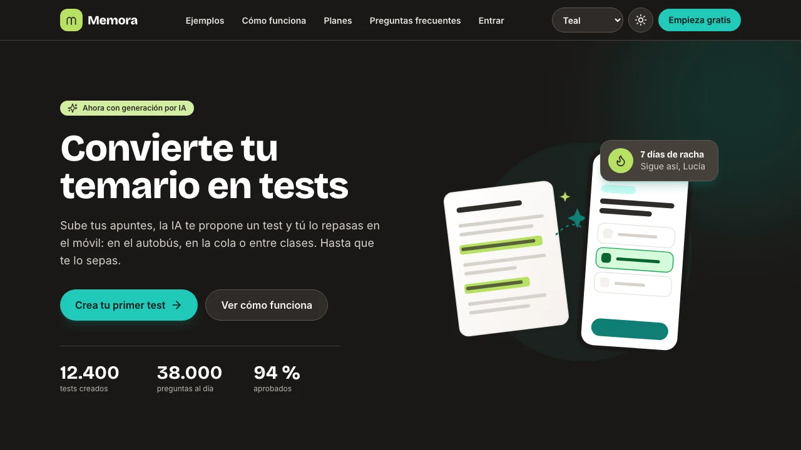
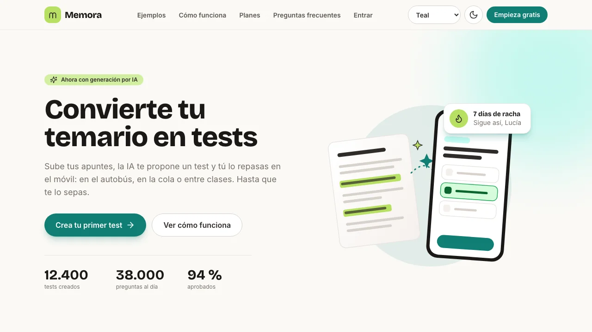
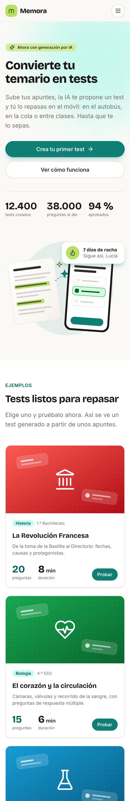
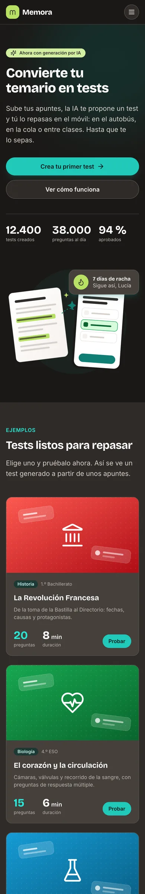

# Memora · Laboratorio Módulo 01 (Layout + Tailwind CSS)

Maquetación con **Tailwind CSS v4** y **Vite** de la landing de mi TFM.



## Memora

**Memora** es una aplicación web para estudiar con tests. Pegas tu temario o subes un PDF, eliges cuántas preguntas quieres y de qué tipos (respuesta única, múltiple, verdadero/falso o respuesta corta), y una IA te propone un test. Lo revisas, lo editas y lo repasas en el móvil tantas veces como quieras hasta que te lo sabes.

**Pantalla maquetada:** la **landing** de registro del producto (`index.html`). Solo es maquetación: los datos son inventados y no hay backend.

| Pieza que pide el lab | Dónde está en la landing |
| --- | --- |
| Cabecera + menú | Logo, enlaces (Ejemplos, Cómo funciona, Planes, Preguntas frecuentes, Entrar), selector de tema, modo oscuro y «Empieza gratis». Hasta 1023 px, menú hamburguesa |
| Hero | «Convierte tu temario en tests», dos botones, cifras e ilustración |
| Tarjetas | 6 tests de ejemplo (Historia, Biología, Química, Matemáticas, Inglés, Derecho) |
| Cómo funciona (3 pasos) | Sube tu temario → La IA te propone un test → Repásalo en el móvil |
| Opiniones | Mini bento con 3 testimonios y 2 cifras. La misma tarjeta de testimonio sale en horizontal o en vertical según su celda (container queries) |
| Planes con destacado | Gratis · **Estudiante** (Más popular) · Academia |
| FAQ | 5 preguntas plegables |
| Pie + newsletter | 4 columnas, redes, contacto y formulario de suscripción |

## Cómo arrancarlo

Hace falta Node.js 20 o superior.

```bash
npm install
npm run dev      # desarrollo en http://localhost:5173
npm run build    # build de producción en dist/
npm run preview  # sirve dist/ (es lo que he pasado por Lighthouse)
```

## Integración de Tailwind: Opción 1, plugin de Vite

He usado `@tailwindcss/vite` (en `vite.config.js`):

- Es la opción que recomienda la documentación de Tailwind v4 cuando el proyecto ya usa Vite.
- Es más rápida: el plugin trabaja dentro del propio Vite, sin una capa de PostCSS por medio.
- Necesita menos configuración: no hay `postcss.config.mjs` ni `autoprefixer`, porque Tailwind v4 ya añade los prefijos.

No hay `tailwind.config.js`. Todo el tema está en `src/style.css`, dentro de `@theme`:

- **Colores:** `marca` (teal, el que cambia con el tema), `chispa` (lima, el acento), `acierto`, `fallo` e `info`, con 11 tonos cada una, y `neutral` del 0 al 1000. Todos en `oklch()`.
- **Fuentes:** Bricolage Grotesque para los títulos (`font-display`) e Inter para el texto (`font-sans`), las dos servidas desde el proyecto con Fontsource. Solo se carga el subconjunto latino y se precarga en el `<head>`.
- **Animaciones propias:** `animate-aparecer` y `animate-flotar`, con sus `@keyframes`.

En el HTML no hay ni un color «a pelo» (`bg-[#…]`) ni clases de la paleta por defecto de Tailwind: todo sale de los tokens.

## Decisiones de maquetación

### Hero con grid y no con flex

`grid md:grid-cols-2 items-center`: quiero **dos columnas iguales** pase lo que pase con el contenido. Con flex tendría que forzarlo con `flex-1 basis-0` en cada hijo. En móvil no hace falta nada, porque un grid sin `grid-cols` ya apila en una columna. El párrafo lleva `max-w-prose` para que las líneas no se hagan eternas.

### Pasos con flex y tarjetas con grid

- **«Cómo funciona»** es una sola fila de tres elementos iguales: `flex flex-col md:flex-row`. Cada paso se centra con `flex flex-col items-center justify-center text-center`.
- **Las tarjetas** son una rejilla en dos dimensiones que cambia de columnas: `grid grid-cols-1 sm:grid-cols-2 lg:grid-cols-3`. Las imágenes usan `aspect-video object-cover` para que todas tengan el mismo alto sin deformarse.

### Cabecera `sticky` y no `fixed` (P2)

- `sticky` mantiene la cabecera **en el flujo de la página**: ocupa su hueco y el contenido no queda debajo al cargar. Con `fixed` saldría del flujo y tendría que compensar con un `padding-top` en el `body`.
- Además, `scroll-padding-top` en el `html` hace que, al pulsar un enlace del menú, el título de la sección no quede tapado.
- **`z-50` hace falta** porque, al hacer scroll, la cabecera pasa por encima de elementos que crean su propio contexto de apilamiento: tarjetas con `transform` en hover, elementos `relative` con hijos `absolute`… Sin `z-index`, esos elementos se pintarían **encima** de la cabecera.
- `bg-neutral-50/75 backdrop-blur-md` da el efecto cristal: fondo semitransparente y lo de detrás desenfocado.

### Menú hamburguesa en móvil y tablet

Hasta 1023 px (por debajo del punto de corte `lg:`), los enlaces, el tema, el modo oscuro y «Empieza gratis» se recogen en un menú desplegable. Desde 1024 px se ve la barra completa. Se alterna con dos clases: `hidden lg:block` en la barra y `lg:hidden` en el botón y el menú.

- El estado del menú vive en **atributos**: `aria-expanded` en el botón y `hidden` en el panel. El icono cambia de ☰ a ✕ solo con CSS (`group` en el botón y `group-aria-expanded:hidden` / `group-aria-expanded:block` en los iconos).
- Se cierra con **Escape** (y el foco vuelve al botón), al pulsar un enlace, al hacer clic fuera y al ensanchar la ventana hasta escritorio.
- Dentro del menú, el tema son tres chips (radios con `has-checked:`) y el modo oscuro, un interruptor. Están sincronizados con los controles de escritorio.
- Usa un poco de JavaScript, así que no cuenta como el desafío D1 (hamburguesa sin JS).

### Modo oscuro con botón (P1)

```css
@custom-variant dark (&:where(.dark, .dark *));
```

Un script pequeño en el `<head>` pone la clase `.dark` **antes de pintar**, así no hay parpadeo. Usa la preferencia guardada o, si no hay ninguna, la del sistema. El botón la alterna, la guarda y actualiza `aria-pressed`.

### Multitema: Teal, Azul Klein y Amarillo (D3)

Tailwind genera `bg-marca-600` como `background-color: var(--color-marca-600)`. Así que basta con **redefinir las variables** bajo un atributo:

```css
@layer base {
  [data-theme="klein"] {
    --color-marca-600: oklch(0.56 0.234 264);
    /* … */
  }
}
```

El selector de la cabecera solo cambia `data-theme` en `<html>`; **el HTML no cambia**. Va en `@layer base` porque una capa posterior gana a una anterior (`base` va después de `theme`), sea cual sea la especificidad. Se combina con el modo oscuro: 3 temas × 2 modos.

### Opiniones: mini bento (P6) con container queries (D2)

**Bento (P6).** La rejilla es `grid sm:grid-cols-2 lg:grid-cols-3` y mezcla cajas de distintos tamaños:

```
┌───────────┬─────┐
│           │ 4,8 │
│   Lucía   ├─────┤
│           │ +12k│
├─────┬─────┴─────┤
│Dani │   Marta   │
└─────┴───────────┘
```

- Lucía ocupa 2 columnas y 2 filas (`sm:col-span-2 lg:row-span-2`), y Marta 2 columnas (`lg:col-span-2`).
- Las dos cifras son cajas de una celda con fondo de marca y de acento.
- No hace falta `grid-flow-dense`: con este orden en el HTML, la colocación automática ya llena la rejilla sin huecos, y el orden de lectura y de tabulación coincide con el visual.

**Container queries (D2).** Las tres tarjetas de testimonio tienen **exactamente las mismas clases**. Cada `<li>` lleva `@container` y la tarjeta usa `@xl:flex-row`: se pone en horizontal cuando **su hueco** mide 36rem o más, no cuando la ventana es ancha.

- En escritorio, Lucía y Marta están en celdas de 2 columnas y salen en horizontal; Daniel está en una celda de 1 columna y sale en vertical. En la misma pantalla conviven las dos versiones de la misma tarjeta.
- En tablet pasa lo mismo: Lucía ocupa la fila entera (horizontal) y Daniel y Marta comparten fila (vertical). En móvil, las tres van en vertical.
- Con `md:` o `lg:` esto no se podría hacer: todas las tarjetas cambiarían a la vez, porque la ventana es la misma para todas.

### Formulario con estados (P5)

La newsletter del pie tiene `<label>` en cada campo y estilos `focus:`, `user-invalid:` y `disabled:`. El mensaje de error es un hermano del input y solo aparece con `peer-user-invalid:block`. Uso `user-invalid:` en lugar de `invalid:` para que el error **no salga nada más cargar**, sino después de que el usuario haya escrito algo. El botón se desactiva mientras el formulario no es válido.

### Animaciones (P7)

Todo lo que se mueve lleva `motion-safe:`: la entrada en cascada del hero (`animate-aparecer` con `[animation-delay:…]`), la tarjeta flotante de la racha, el `-translate-y` de los hovers y el zoom de las imágenes. Los cambios de color y de sombra no lo necesitan.

## Accesibilidad (O8)

- Recorrido completo con **Tab** en escritorio y en móvil, también con el menú abierto: todos los elementos interactivos son alcanzables y muestran el foco.
- Enlace «Saltar al contenido», un solo `<h1>` y títulos sin saltos de nivel.
- Los iconos decorativos llevan `aria-hidden`; los enlaces «Probar» añaden el nombre del test en `sr-only`.
- He revisado el contraste con **axe-core** en los 3 temas, en claro y en oscuro, a 390 y a 1280 px: **0 errores**. Lo hice porque Lighthouse solo mide el modo claro.
- Ninguna imagen contiene texto.

## Lighthouse

Medido sobre `npm run preview`, con emulación móvil:

| Rendimiento | Accesibilidad | Buenas prácticas | SEO |
| --- | --- | --- | --- |
| **100** | **100** | **100** | **100** |

## Capturas

Tema Teal. Escritorio a 1280 × 720 px y móvil a 390 × 844 px (el viewport de un teléfono, sin scroll). Muestran el hero.

| Escritorio, claro | Escritorio, oscuro | Móvil, claro | Móvil, oscuro |
| --- | --- | --- | --- |
|  |  |  |  |

## Checklist

### Obligatorios

- [x] O1 · Estructura semántica
- [x] O2 · Tema visual con `@theme`
- [x] O3 · Cabecera con flexbox
- [x] O4 · Hero
- [x] O5 · Rejilla de tarjetas con grid
- [x] O6 · Pasos con flexbox
- [x] O7 · Pie de página
- [x] O8 · Accesibilidad mínima (Lighthouse 100)
- [x] O9 · README + bitácora de IA

### Opcionales

- [x] P1 · Modo oscuro con botón
- [x] P2 · Cabecera fija con efecto cristal
- [x] P3 · Planes con tarjeta destacada
- [x] P4 · FAQ plegable sin JavaScript
- [x] P5 · Formulario con estados
- [x] P6 · Bento grid
- [x] P7 · Animaciones con `motion-safe:`

### Desafíos

- [ ] D1 · Menú hamburguesa sin JS
- [x] D2 · Container queries
- [x] D3 · Multitema
- [ ] D4 · Utilidades propias
- [ ] D5 · Layout de aplicación
- [ ] D6 · De captura a código
- [x] D7 · Lighthouse al 100 (las cuatro categorías)

## 🤖 Bitácora de IA

**Herramientas:** Claude, en Claude Code y en Cowork. Antes de maquetar escribí con la IA la documentación del producto (funcionalidades, sistema de diseño y requisitos del lab). Después generé con ella varias versiones de la landing a partir de esos documentos. La landing está revisada con Lighthouse y axe-core (ver [Accesibilidad](#accesibilidad-o8)).

### 1 · Probar el generador con otros sistemas de diseño

#### Prompt

«Vamos a hacer una prueba para testar nuestro modelo de agentes para el producto del curso Lemoncode. En este caso vamos a crear la landing inicial utilizando las reglas de diseño de Revolut. Vas a crear una landing page tal como se define en la práctica de la fase 01, siguiendo el desarrollo definido por la documentación de `/lemoncode-project`, a excepción de `design.md`: vas a utilizar el de `/lemoncode-tfm/product-01/docs/DESIGN.md`. Todo el output de esta landing debe ir dentro de la carpeta `product-01`.»

#### Qué me dio

Una landing de Memora correcta y con «sabor» a Revolut, pero aplicado por encima:

- Cambió los colores y la forma de los botones, y mantuvo la estructura de siempre.
- Tomó decisiones que no le había pedido: quitó la tipografía de títulos por «demasiado juguetona» y eliminó el selector de temas (D3) porque Revolut solo tiene una paleta.

#### Qué corregí y por qué

No toqué el código: corregí **lo que le daba a la IA**, en varias vueltas.

1. **`product-02`:** pedí una versión más fiel a Revolut. Esta vez detallé en el prompt sus rasgos más característicos y le di más libertad creativa. El resultado sí aplicó el estilo de verdad: pantallas de la app como prueba visual, tarjetas con acabado metálico, y el espaciado entre letras y las sombras como tokens en `@theme`.
2. **`product-03`:** le di un origen totalmente distinto, una web real, para ver cómo trasladaba un estilo existente.
3. **`product-04`:** con lo aprendido, reescribí el `design.md` de Memora con mucho más detalle, sobre todo en **color** (familias, tonos, temas y reglas de contraste) y **tipografía** (fuentes y escala para cada nivel de texto). Con ese documento generé la versión que es la base de esta landing.

Lo que aprendí: **la IA aplica un sistema de diseño tan bien como esté descrito**. Si un criterio es ambiguo, lo interpreta a su manera o directamente lo descarta. La mejora no estuvo en corregir clases a posteriori, sino en escribir mejor las especificaciones de partida.

### 2 · Rendimiento: entorno local o problema real

#### Prompt

«He pasado Lighthouse desde DevTools y me da una puntuación de 82 en rendimiento. He visto que hay varios puntos relativos a la carga de recursos del localhost. Necesito que analices si eso es particular del entorno o es un problema que puede reproducirse también en producción. Revisa el resto de alertas y recomendaciones y dime qué podemos mejorar. Te paso el informe.»

#### Qué me dio

Que muchas de las alertas eran propias del entorno local y no se reproducirían en producción. Pero que sí se podía mejorar la carga de la tipografía:

1. Importar solo el subconjunto latino de Inter y de Bricolage Grotesque, en lugar de los paquetes completos de Fontsource, que declaran 8 `@font-face` de alfabetos que la página no usa.
2. Precargar los dos `.woff2` latinos, para que el navegador no espere a descargar y leer el CSS antes de pedir las fuentes.

#### Qué corregí y por qué

Apliqué las dos mejoras:

- **`src/fonts.css`** declara solo los dos `@font-face` latinos, que cubren todo el español (ñ, tildes, ¿, ¡, €). El CSS pesa menos y el build ya no genera archivos de fuentes que nunca se descargan.
- **Un pequeño plugin en `vite.config.js`** añade al `<head>` un `<link rel="preload" as="font" crossorigin>` por cada fuente. Lo hace en el build y no a mano porque Vite añade un hash al nombre de los archivos, así que la ruta no se conoce de antemano. El `crossorigin` es obligatorio en la precarga de fuentes; sin él, el navegador las descarga dos veces.

Volví a pasar Lighthouse sobre `npm run preview` (el build que se publicaría) y el rendimiento subió de 82 a **100**.

### 3 · Menú hamburguesa en móvil

#### Prompt

«En mobile los accesos de la navbar se apilan en horizontal y la elección de modo de color y de tema toma demasiada relevancia. Necesitamos añadir un menú hamburguesa en mobile siguiendo los patrones de diseño que ya hemos utilizado para la elaboración de la landing. El menú hamburguesa entra en juego de 1023 píxeles inclusive hacia abajo. Este menú debe incluir los accesos a las distintas anclas de la landing y también la configuración de modo de color y temas.»

#### Qué me dio

Lo que le pedí: un botón ☰ que aparece hasta 1023 px y abre un panel con los enlaces a las secciones, el tema de color como chips, el modo oscuro como interruptor y el botón «Empieza gratis». Reutiliza los patrones que ya tenía la landing (chips con `has-checked:`, mismos colores, radios y estados de foco) y se puede usar con teclado: Escape lo cierra y devuelve el foco al botón.

#### Qué corregí y por qué

En este caso la corrección no fue sobre la respuesta, sino sobre la versión anterior de la cabecera. Revisándola en el móvil vi dos problemas que la IA había dado por buenos:

- Los cinco enlaces se apretaban en una segunda fila horizontal.
- El selector de tema y el botón de modo oscuro competían con el logo y con la llamada a la acción.

Es un problema de jerarquía visual más que técnico, y por eso no salía en Lighthouse ni en axe. El punto de corte que pedí, 1023 px, coincide con el límite de `lg:` en Tailwind (1024 px). Por eso la barra completa y el menú se alternan con un solo prefijo (`hidden lg:block` / `lg:hidden`), sin valores arbitrarios.

## Estructura

```
├── index.html          # La landing
├── src/
│   ├── fonts.css       # @font-face del subconjunto latino
│   ├── style.css       # @import "tailwindcss" + @theme + temas
│   └── main.js         # Modo oscuro, tema, menú y newsletter
├── public/             # Favicon, robots.txt e ilustraciones SVG
├── docs/
│   └── capturas/       # Capturas de este README
└── vite.config.js      # Plugin de Tailwind y precarga de fuentes
```

## Créditos

- Iconos: [Lucide](https://lucide.dev).
- Fuentes: Inter y Bricolage Grotesque vía [Fontsource](https://fontsource.org).
- Textos, datos y precios inventados.
