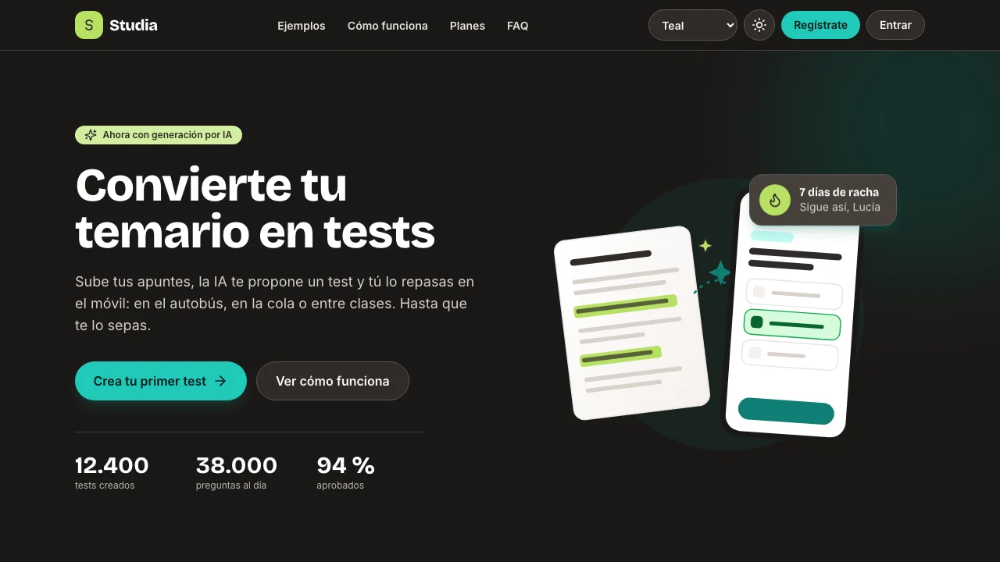
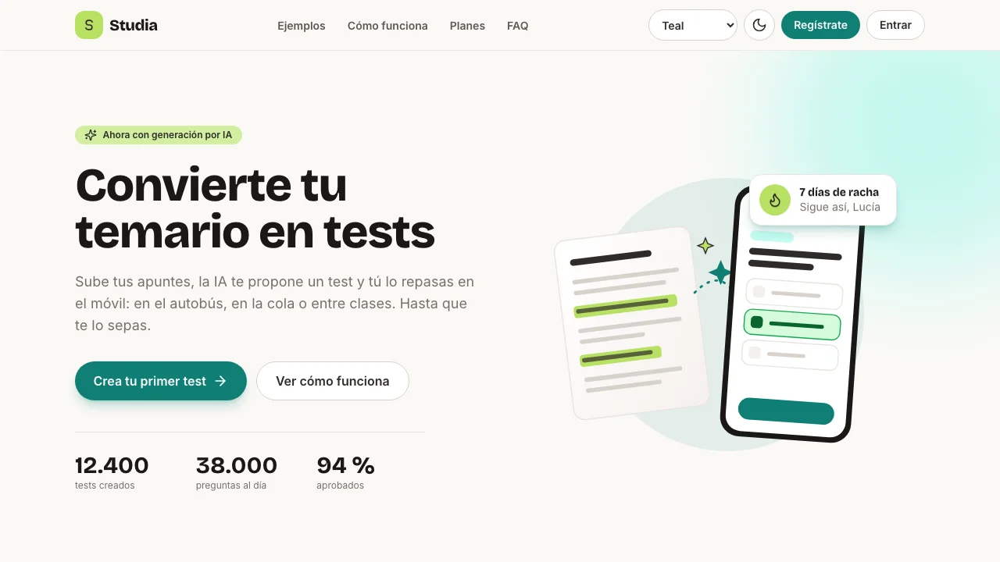
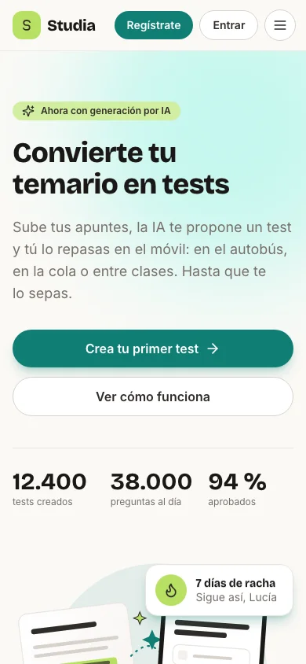
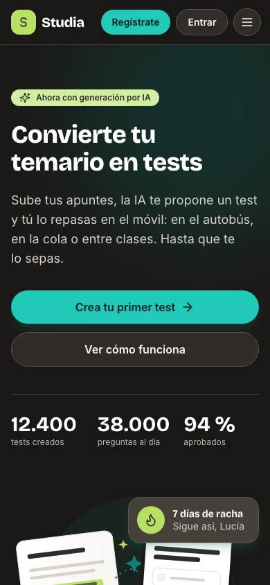

# Studia · Trabajo Fin de Máster

Aplicación web para estudiar con tests: subes tu temario en PDF y una IA te propone las preguntas. Construida con **TanStack Start**, **React** y **Tailwind CSS v4** en un monorepo con **pnpm** y **Turborepo**.



## Studia

**Studia** es una aplicación para estudiar con tests. Subes un PDF con tu temario, eliges cuántas preguntas quieres y de qué tipo (respuesta simple, múltiple o mixta), y la IA de Google (Gemini) te propone un test. Lo guardas en tu panel y lo haces tantas veces como quieras hasta que te lo sabes.

> Antes se llamaba **Memora**. El repositorio se renombró a Studia cuando el nombre pasó a ser el definitivo. La entrega del laboratorio del módulo 1 (solo la landing, con Vite y Tailwind) sigue en la rama [`lab-01`](https://github.com/4tl4sh/studia/tree/lab-01).

### Qué hay hoy

| Parte | Qué hace |
| --- | --- |
| **Landing** (`/studia/`) | Cabecera con selector de tema, modo oscuro y menú móvil. Hero, ejemplos de tests, cómo funciona, opiniones, planes con destacado, FAQ y pie con newsletter. Los datos, precios y opiniones son inventados |
| **Registro y acceso** | Registro con nombre, correo y contraseña (mínimo 6 caracteres) y login con esas credenciales. Los usuarios y la sesión se guardan en el navegador: es una **simulación**, la contraseña se guarda en claro y no hay servidor. Cada usuario solo ve sus propios tests |
| **Panel** (`/studia/private/`) | Lista de tus tests con filtro por materia, menú de acciones por test (realizar o borrar, con confirmación) y estado vacío si todavía no hay ninguno |
| **Crear un test** | Con asistencia de IA: subes un PDF (hasta 5 MB), eliges 5, 10 o 15 preguntas, el tipo (simple, múltiple, verdadero o falso, o mixta con los tres) y la materia. O a mano, escribiendo título, materia y preguntas (simple, múltiple o verdadero/falso) |
| **Editar un test** | Los tests manuales se editan por completo. Los de IA solo permiten cambiar título y materia, porque sus explicaciones y su origen dependen de las preguntas. Para retocarlos, o para partir de un test que ya tienes, está «Duplicar» (en los de IA, «Duplicar como manual»): la copia es siempre manual |
| **Hacer un test** (`/tests/:id`) | Todas las preguntas en una página, con el progreso siempre a la vista y botón de finalizar. Al terminar se muestra el resultado con confeti |
| **Preferencias** | Tres temas de color (Teal, Azul Klein y Amarillo) y modo oscuro, combinables |

Usuarios, sesión y tests se guardan en `localStorage`: por ahora **no hay base de datos conectada** y nada se comparte entre navegadores ni dispositivos.

### Cómo genera el test la IA

La generación ocurre en el servidor, en una *server function* de TanStack Start (`apps/front/src/server/generate-test.ts`):

1. El navegador envía el PDF y las opciones elegidas.
2. El servidor extrae el texto con `pdf-parse` (se recorta a 60.000 caracteres).
3. Pide a Gemini un JSON con un esquema fijo (título, enunciados, opciones, respuestas correctas y una explicación corta).
4. Valida y adapta la respuesta al tipo pedido, y solo devuelve al navegador las preguntas, no el texto del PDF.

El modelo por defecto es `gemini-flash-lite-latest` (rápido y con menos saturación en el plan gratuito). Se puede cambiar con `GEMINI_MODEL`.

## Stack

- **TanStack Start** + **TanStack Router** (rutas por archivos) sobre **Vite**, con **Nitro** como servidor
- **React 19** y **TypeScript**
- **Tailwind CSS v4**: todo el tema está en `apps/front/src/styles.css`, con colores en `oklch()` y sin valores sueltos
- **Gemini** (`@google/genai`) para generar los tests y **pdf-parse** para leer los PDF
- **pnpm** (workspaces) y **Turborepo** para el monorepo
- Tipografías Bricolage Grotesque e Inter con Fontsource

## Estructura

```
├── apps/
│   └── front/                 # La aplicación (landing, panel y tests)
│       └── src/
│           ├── routes/        # Rutas por archivos: studia/, studia/private/, tests/$id
│           ├── components/    # landing/, home/ (panel), test/, layout/, auth/, ui/
│           ├── server/        # generate-test.ts y pdf-to-text.ts (solo servidor)
│           ├── lib/           # Sesión y tests en localStorage, utilidades
│           └── styles.css     # Tailwind y tema
├── packages/
│   ├── types/                 # Tipos compartidos (tests, preguntas, usuarios) y funciones puras
│   └── db/                    # Conexión a MongoDB con Mongoose (aún sin usar en el front)
├── docker-compose.yml         # MongoDB 8 para desarrollo local
├── turbo.json
└── pnpm-workspace.yaml
```

## Cómo arrancarlo

Hace falta **Node.js 22 o superior** (probado con 26) y **pnpm 12** (el proyecto fija `pnpm@12.15.0`).

```bash
pnpm install
pnpm dev        # http://localhost:3000, redirige a /studia/
pnpm build      # build de producción
pnpm typecheck
```

> `pnpm 12` termina `pnpm install` con un aviso de error (`ERR_PNPM_IGNORED_BUILDS`) por los scripts de instalación de `@google/genai` y `protobufjs`, que no se ejecutan. Las dependencias quedan bien instaladas. Si necesitas un código de salida limpio (por ejemplo en un despliegue), usa `pnpm install --config.strictDepBuilds=false`.

### Variables de entorno

Crea el archivo `apps/front/.env` (está en el `.gitignore`: nunca se sube):

```bash
GEMINI_API_KEY=tu_clave_de_google_ai_studio
# GEMINI_MODEL=gemini-flash-lite-latest   # opcional
```

Sin la clave, todo funciona menos la generación de tests con IA. Reinicia el servidor después de cambiar el `.env`: se lee al arrancar.

### MongoDB (opcional)

El paquete `@tfm/db` está preparado para MongoDB, pero el front todavía no lo usa. Para tener una base local:

```bash
cp .env.example .env
pnpm db:up      # levanta MongoDB 8 con Docker
pnpm db:logs
pnpm db:down
```

## Despliegue en Vercel

No hace falta ningún archivo de configuración: al compilar en Vercel, Nitro detecta la plataforma solo. En el proyecto de Vercel:

- **Root Directory**: `apps/front`
- **Application Preset**: Nitro
- **Install Command**: `pnpm install --config.strictDepBuilds=false`
- **Variable de entorno**: `GEMINI_API_KEY` (en Production y Preview)

Limitaciones conocidas: el cuerpo de una petición a una función de Vercel tiene un límite de 4,5 MB, así que los PDF entre 4,5 y 5 MB fallarían. Y la base de datos, cuando se conecte, tendrá que estar fuera de Vercel (por ejemplo, MongoDB Atlas).

## Ramas y versiones

| Rama | Contenido |
| --- | --- |
| `main` | La aplicación Studia (este monorepo) |
| `lab-01` | Laboratorio del módulo 1: la landing con Vite y Tailwind, con sus etiquetas `v0.0.1` a `v0.1.0` y la release `v0.1.0` |

Las dos ramas tienen historias independientes. La versión `1.0.0` se reserva para el TFM completo.

## Capturas

Tema Teal. Escritorio a 1280 × 720 px y móvil a 390 × 844 px. Muestran el inicio de la landing.

| Escritorio, claro | Escritorio, oscuro | Móvil, claro | Móvil, oscuro |
| --- | --- | --- | --- |
|  |  |  |  |

## Créditos

- Fuentes: Inter y Bricolage Grotesque vía [Fontsource](https://fontsource.org).
- Textos, datos y precios de la landing inventados.
